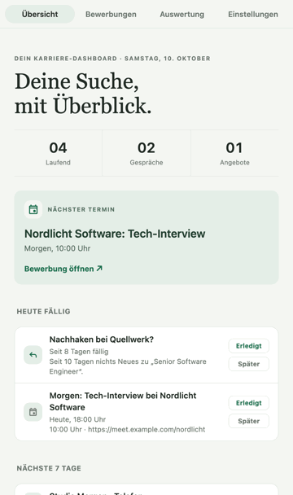
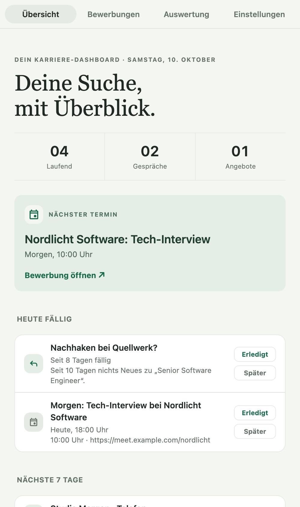
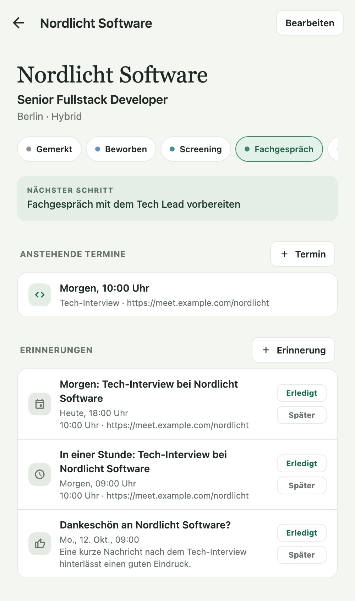
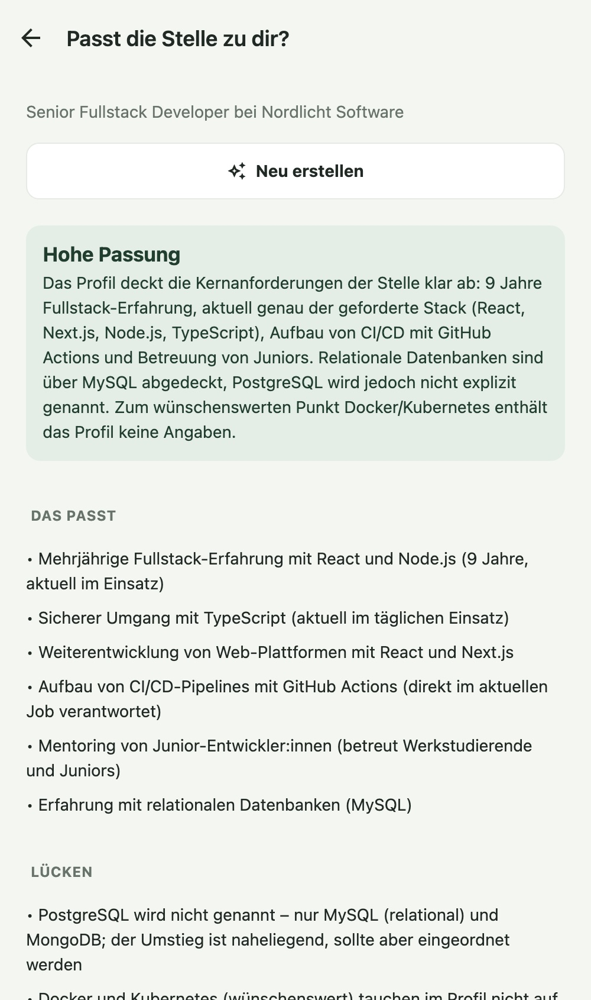
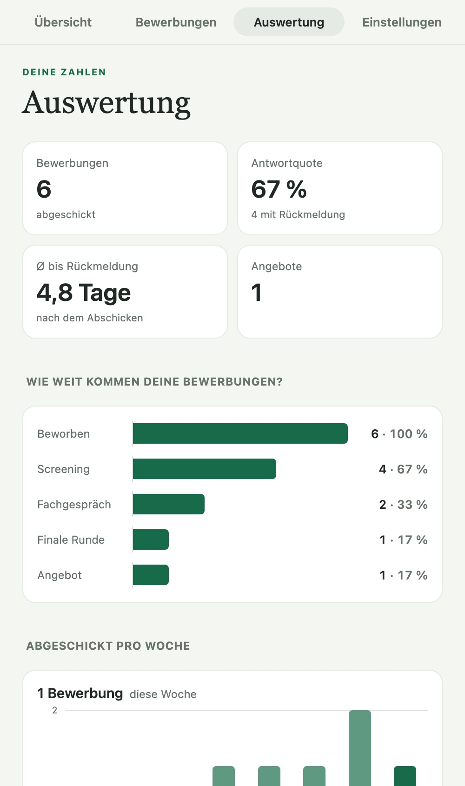
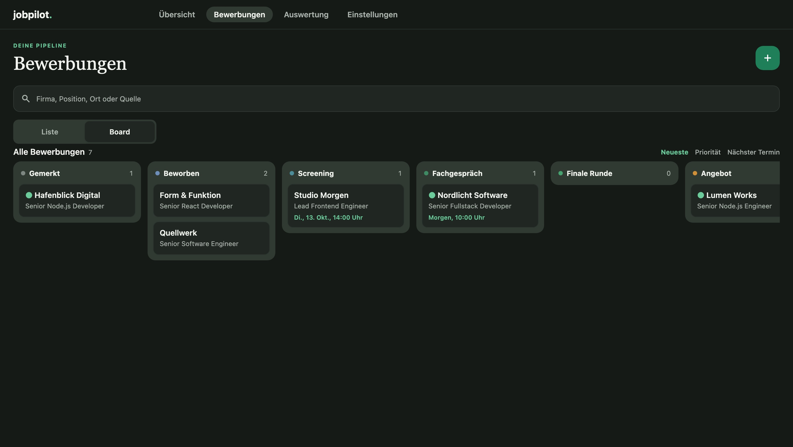
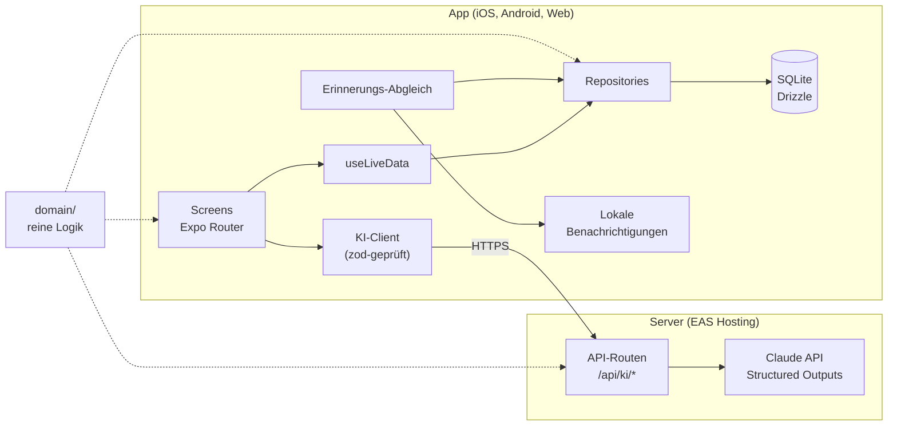

# jobpilot

**Bewerbungen im Blick behalten** – eine App für die eigene Jobsuche, von der ersten Anzeige bis zum Angebot. Für iOS, Android und Web, mit lokalem Datenspeicher, Erinnerungen und einem KI-Assistenten auf Basis von Claude.

[](https://github.com/Mythos-Brookdesign/jobpilot/actions/workflows/ci.yml)

**[Live-Demo im Browser →](https://jobpilot.expo.app)** &nbsp;·&nbsp; ohne Anmeldung, mit Beispieldaten, alles bleibt im Browser

<p align="center">
  
</p>

## Funktionen

- **Pipeline** von „Gemerkt“ über Screening und Fachgespräch bis zum Angebot; jeder Statuswechsel landet im Verlauf
- **Detailseite** je Bewerbung: Eckdaten (Gehalt, Arbeitsmodell, Quelle, Link), Termine, Kontakte, Notizen, Verlauf
- **Erinnerungen** als Benachrichtigung: nachhaken, wenn sich nichts tut, Termine am Vortag und eine Stunde vorher, Dankeschön danach – mit „Erledigt“ und „Später“ direkt in der Benachrichtigung
- **KI-Assistent (Claude):** Stellenanzeige einfügen und Felder vorausfüllen lassen, Passung zum eigenen Profil, Gesprächsvorbereitung, Entwürfe für Anschreiben, Nachfass- und Dankes-Mail
- **Auswertung:** Funnel nach höchster erreichter Stufe, Antwortquote, Zeit bis zur Rückmeldung, Erfolg je Quelle, Aktivität pro Woche
- **Board-Ansicht** auf breiten Bildschirmen, Hell- und Dunkelmodus, native Tabs und Datums-Picker
- **Offline und privat:** alle Daten lokal in SQLite; Backup als JSON, Export als CSV

| Übersicht                                        | Detailseite                                    | KI: Passung                                 | Auswertung                                        |
| ------------------------------------------------ | ---------------------------------------------- | ------------------------------------------- | ------------------------------------------------- |
|  |  |  |  |



## Architektur



- **`domain/`** enthält die Geschäftslogik als reine Funktionen: Pipeline, Filter, Sortierung, Formular-Validierung, Erinnerungsregeln, Auswertungen, Backup-Format, KI-Schemas. Sie wird von App, Datenbankschicht und Server gemeinsam genutzt und ist ohne React getestet.
- **Datenzugriff nur über Repositories**, geschrieben gegen jeden synchronen SQLite-Treiber von Drizzle: expo-sqlite in der App, better-sqlite3 in den Tests – die Tests prüfen echtes SQL mit denselben Migrationen.
- **Der API-Key existiert nur auf dem Server.** App und Server teilen sich die zod-Schemas für Anfragen und Antworten.

### Entscheidungen

|                                                                  |                                                                                     |
| ---------------------------------------------------------------- | ----------------------------------------------------------------------------------- |
| [ADR 1](docs/adr/0001-lokale-daten-mit-sqlite-und-drizzle.md)    | Lokale Daten mit SQLite und Drizzle, versionierte Migrationen                       |
| [ADR 2](docs/adr/0002-live-daten-mit-gebuendeltem-neuladen.md)   | Live-Daten mit gebündeltem Neuladen statt einer Abfrage pro Zeile                   |
| [ADR 3](docs/adr/0003-erinnerungen-als-idempotenter-abgleich.md) | Erinnerungen als idempotenter Abgleich von Regeln, Datenbank und Benachrichtigungen |
| [ADR 4](docs/adr/0004-patches-fuer-expo-sqlite.md)               | Zwei Fehler in expo-sqlite (Web) gefunden und per Patch behoben                     |
| [ADR 5](docs/adr/0005-ki-ueber-eigene-api-routen.md)             | KI über eigene API-Routen, Structured Outputs, abgesicherte öffentliche Demo        |

## Tech-Stack

- [Expo](https://expo.dev) SDK 57, React Native 0.86, React 19 mit React Compiler, Expo Router
- SQLite über `expo-sqlite` und [Drizzle ORM](https://orm.drizzle.team), im Browser per WebAssembly
- `expo-notifications` für lokale Erinnerungen
- [Claude API](https://docs.claude.com) (Claude Opus 5.5) über Expo Router API Routes, zod für alle Schnittstellen
- TypeScript (strict), Jest mit `jest-expo`, React Native Testing Library, better-sqlite3
- ESLint, Prettier, GitHub Actions; Auslieferung über EAS Hosting

## Qualität

- **124 Tests**: Domain-Logik, Repositories gegen echtes SQLite, eine Migration mit Daten im alten Format, Erinnerungsregeln und -abgleich, KI-Server mit nachgebautem Anthropic-Client, Demo-Schutz, Hooks und Komponenten
- CI prüft Lint, Typecheck und Tests bei jedem Push und Pull Request
- Barrierefreiheit: Labels und Rollen für Screenreader, Kontraste nach WCAG AA (Status- und Diagrammfarben rechnerisch geprüft)

## Projektstruktur

```
src/
  app/          Routen (Expo Router) – Tabs, Detailseite, Formulare, API-Routen
  domain/       reine Logik ohne React
  db/           Schema, Repositories, Datenbankanbindung, Live-Abfragen
  features/     applications/, insights/, reminders/, ai/, demo/, data-transfer/
  server/       nur für API-Routen: Claude-Anbindung, Prompts, Rate-Limit
  ui/           wiederverwendbare Bausteine
  theme/        Farben für Hell und Dunkel
drizzle/        SQL-Migrationen
docs/           Architektur-Entscheidungen und Screenshots
patches/        Korrekturen an Abhängigkeiten (patch-package)
```

## Starten

Voraussetzung: Node.js 22

```bash
npm install
npm start          # Dev-Server, dann i (iOS) oder a (Android) – oder QR-Code mit Expo Go scannen
```

### KI-Assistent einrichten

```bash
cp .env.example .env.local   # ANTHROPIC_API_KEY eintragen
npm start                    # der Dev-Server stellt auch die API-Routen bereit
```

Ohne Key funktioniert die App normal, nur der Assistent meldet, dass er nicht eingerichtet ist.

### Web-Version

```bash
npm run web:preview          # Export und Auslieferung wie in Produktion (inkl. API-Routen)
```

`npm run web` (Dev-Server) scheitert in Expo SDK 57 am SQLite-Worker („Worker chunk not found“) – ein Fehler in Expos Dev-Serializer. Die Vorschau oben ist davon nicht betroffen.

### Datenbank

```bash
# nach Änderungen an src/db/schema.ts die nächste Migration erzeugen
npm run db:generate -- --name kurze-beschreibung
```

Migrationen werden beim App-Start automatisch angewendet.

## Qualität prüfen

```bash
npm run lint       # ESLint und Prettier
npm run typecheck  # TypeScript
npm test           # Jest
npm run check      # alles zusammen, wie in der CI
```

## Web-Demo veröffentlichen

Die Demo ist die normale Web-Version mit `EXPO_PUBLIC_DEMO=1` (Beispieldaten, Hinweisband) und `JOBPILOT_DEMO=1` auf dem Server (KI nur mit den Demo-Inhalten, Antworten zwischengespeichert).

```bash
# einmalig: Umgebungsvariablen in EAS („production“)
npx eas-cli@latest env:create --environment production --name ANTHROPIC_API_KEY --visibility secret
npx eas-cli@latest env:create --environment production --name JOBPILOT_DEMO --value 1 --visibility plaintext
npx eas-cli@latest env:create --environment production --name EXPO_PUBLIC_DEMO --value 1 --visibility plaintext

npm run deploy:web   # Export mit Demo-Modus und Deployment auf EAS Hosting
```

Mit verbundenem GitHub-Repo veröffentlicht `.eas/workflows/deploy-web.yml` die Demo bei jedem Push auf `main` automatisch.
